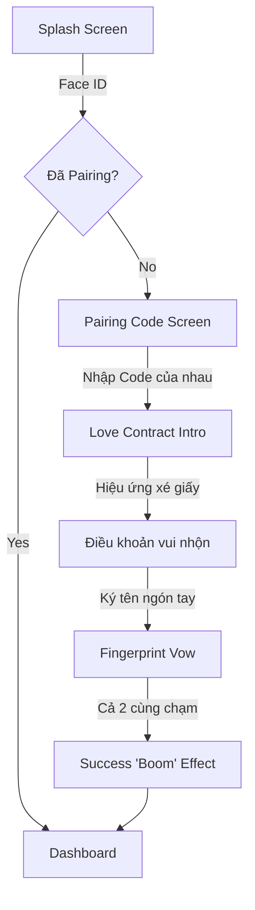

# UX Design Specification — Cupid

**Author:** alan
**Date:** 2026-02-13

---

<!-- UX design content will be appended sequentially through collaborative workflow steps -->

## Executive Summary

### Project Vision

Cupid là app "couple-first" — mọi tương tác xoay quanh **2 người**, không phải cá nhân. Tông giọng "toxic nhưng vui" tạo UX **playful, provocative** — khác hoàn toàn với Between/Locket. Killer feature Typing Ghost hiển thị real-time keystroke bao gồm phần đã xóa, là concept UX chưa từng có.

MVP: iOS-first, 16 core features, target Gen Z couples Việt Nam.

### Target Users

- **Primary:** Cặp đôi Gen Z Việt Nam (18-30 tuổi)
- **Context:** Quen TikTok, Zalo, Instagram — kỳ vọng app đẹp, phản hồi nhanh
- **Segments:** Yêu xa (cần "cảm giác hiện diện") và cùng thành phố (cần gamification daily)
- **Tech Level:** Tech-savvy, thích share screenshots, hay thử app mới
- **Device:** iPhone (iOS 15+), sử dụng chủ yếu buổi tối và sáng sớm

### Key Design Challenges

1. **Onboarding "Wow Moment"** — Love Contract + Fingerprint Vow phải tạo ấn tượng mạnh ngay lần đầu. Nếu onboarding nhàm chán → mất viral potential.
2. **Typing Ghost UX** — Concept mới hoàn toàn. Phần đã xóa cần khác biệt thị giác rõ ràng với phần đang gõ, không gây rối mắt.
3. **Dual-State Everything** — Mọi tính năng đều có 2 phía (Synced Alarm cần cả 2 xác nhận, Emoji Storm gửi sang bên kia). UX phải rõ "trạng thái của mình" vs "trạng thái đối phương".
4. **3-Tier Data Sensitivity** — Một số dữ liệu chỉ trên device, một số sync. User cần hiểu rõ nhưng không bị overwhelm.
5. **Notification Overload** — 16 features MVP đều có thể push. Cần hierarchy rõ (Critical vs Engagement vs Info).

### Design Opportunities

1. **Viral-by-Design** — Love Contract signing, Typing Ghost screenshots, Emoji Storm reactions → moments tự nhiên để share lên TikTok/Story.
2. **Love Pet as Emotional Dashboard** — Phản ánh sức khỏe mối quan hệ. Thiết kế cute, expressive → engagement hook mạnh.
3. **Micro-interactions "Toxic vui"** — Animation Emoji Storm, countdown Anti-Ghosting, Vibe Check daily → cơ hội tạo UI signature.
4. **Progressive Disclosure for Finance** — Dream Jar, Expense Manager là tính năng "nghiêm túc" trong app "vui". Cần balance tone.

## Core User Experience

### Defining Experience

**Core Action:** Chat với đối phương qua Priority Channel — hành động user làm nhiều nhất. Mọi feature khác (Typing Ghost, Emoji Storm, Anti-Ghosting) đều xoay quanh chat.

**Critical Interaction:** Typing Ghost — nếu trải nghiệm mượt và thú vị → user ở lại. Nếu lag hoặc rối → user bỏ app.

**Effortless Onboarding:** Love Contract → Fingerprint Vow → Dashboard hoàn thành trong < 3 phút cho cả 2 người.

### Platform Strategy

- **iOS Native (Swift)** — tận dụng Face ID/Touch ID, APNs, haptic feedback
- **Touch-first:** Mọi tương tác chính bằng 1 tay (thumb zone)
- **Offline:** Chat history cached cục bộ (Level 1), Love Pet/Timeline xem được offline
- **Device capabilities:** Camera (Private Gallery), Biometrics (Fingerprint Vow), Notifications (Synced Alarm)

### Effortless Interactions

| Tương tác | Thiết kế |
|---|---|
| Mở app → chat | 1 tap duy nhất từ home screen |
| Typing Ghost toggle | Swipe gesture trong chat, không cần vào settings |
| Vibe Check | Push notification → 1 tap chọn mood → done |
| Dream Jar đóng góp | Quick-add số tiền, không cần mở Expense Manager |
| Synced Alarm tắt | Cả 2 swipe cùng lúc — cảm giác "kết nối" |

### Critical Success Moments

1. **"Aha!" moment (phút 1):** Đọc Love Contract → cười → ký → share screenshot
2. **"This is better" moment (ngày 1):** Typing Ghost lần đầu — thấy đối phương xóa rồi viết lại → cười
3. **"Daily habit" moment (tuần 1):** Synced Alarm sáng + Vibe Check → mở app tự nhiên mỗi sáng
4. **"Commitment" moment (tháng 1):** Dream Jar gần đạt mục tiêu → động lực ở lại

### Experience Principles

1. **"Couple-First, Always"** — Mọi screen đều có dấu hiệu đối phương (avatar, status, mood). Không bao giờ cảm thấy dùng app một mình.
2. **"Fun Before Functional"** — Ưu tiên cảm xúc trước tiện ích. Love Contract vui trước khi đầy đủ thông tin.
3. **"One-Thumb Intimacy"** — Mọi tương tác chính hoàn thành bằng 1 ngón cái.
4. **"Transparent by Default"** — Typing Ghost bật mặc định, Vibe Check hiển thị cho cả 2. Minh bạch = niềm tin.
5. **"Delightful Pressure"** — Anti-Ghosting countdown, Love Pet buồn khi ít tương tác. Áp lực nhẹ nhàng, hài hước — không toxic thật.

## Desired Emotional Response

### Primary Emotional Goals

| Cảm xúc | Khi nào | Thiết kế |
|---|---|---|
| **Thích thú / Bất ngờ** | Typing Ghost lần đầu, Love Contract | Animation mượt, micro-interactions bất ngờ |
| **Kết nối / Gần gũi** | Synced Alarm, Vibe Check, Love Pet | Luôn hiển thị trạng thái đối phương real-time |
| **Tự hào / Thành tựu** | Dream Jar đạt mục tiêu, Love Pet lên level | Celebration animation, confetti, badge |
| **Hài hước / Nghịch ngợm** | Emoji Storm, Anti-Ghosting countdown | Over-the-top animation, tông copy "dỗi hờn" |

### Emotional Journey Mapping

| Giai đoạn | Cảm xúc mục tiêu | Anti-pattern (tránh) |
|---|---|---|
| **Khám phá (trước cài)** | Tò mò, FOMO | Nhàm chán, "lại một app nữa" |
| **Onboarding** | Cười, muốn share | Bối rối, phức tạp |
| **Ngày đầu** | "Wow, app này khác!" | Thiếu hướng dẫn → bỏ cuộc |
| **Tuần đầu** | Thói quen hình thành | Quá nhiều notifications → bực |
| **Tháng đầu** | Gắn bó, không muốn bỏ | Hết nội dung mới → chán |
| **Lỗi/sự cố** | Thông cảm, tin tưởng | Hoảng sợ, mất dữ liệu |

### Micro-Emotions

- **Tự tin > Bối rối:** Mỗi tính năng mới có tooltip ngắn gọn + ví dụ thực tế
- **Tin tưởng > Hoài nghi:** Lock icon rõ ràng cho Level 1 data, "Chỉ có trên thiết bị bạn"
- **Hào hứng > Lo lắng:** Typing Ghost hiện banner "Cả 2 đã đồng ý" khi bật
- **Vui vẻ > Khó chịu:** Emoji Storm animation flashy nhưng có nút tắt nhanh
- **Thuộc về > Cô đơn:** Luôn hiển thị "Online/Offline" + last seen của đối phương

### Design Implications

1. **Thích thú** → Haptic feedback khi Fingerprint Vow match, particle effects khi Love Contract ký
2. **Kết nối** → Split-screen layout cho Synced Alarm ("Bạn ✅ | Đối phương ⏳"), partner avatar luôn visible
3. **Hài hước** → Copy UX dùng tông "dỗi": *"Anh/Em đã đọc 5 phút rồi mà chưa trả lời 😤"*
4. **Tin tưởng** → Biểu tượng shield 🛡️ cho Private Gallery, xác nhận rõ ràng trước mỗi hành động nhạy cảm
5. **Thành tựu** → Progress bar animated cho Dream Jar, Love Pet nhảy múa khi tương tác tốt

### Emotional Design Principles

1. **"Cười trước, dùng sau"** — Copy/animation luôn gây cười trước khi truyền tải thông tin
2. **"Áp lực vui"** — Anti-Ghosting, Love Pet buồn = áp lực nhẹ nhàng, KHÔNG bao giờ gây cảm giác toxic thật
3. **"An toàn khi bộc lộ"** — Typing Ghost cho phép thấy suy nghĩ thật nhưng trong không gian an toàn, riêng tư
4. **"Cùng nhau, luôn luôn"** — Mỗi thành tựu/sự kiện hiển thị CHO CẢ HAI, không bao giờ chỉ một bên

## UX Pattern Analysis & Inspiration

### Inspiring Products Analysis

**1. Locket Widget** — *Chia sẻ ảnh tức thì*
- Onboarding siêu đơn giản: Widget setup < 60 giây
- Core loop cực ngắn: Chụp → gửi → đối phương thấy trên home screen
- **Bài học:** Vibe Check nên đơn giản như Locket — 1 tap, instant delivery

**2. TikTok** — *Micro-entertainment*
- Gesture-first navigation: Swipe up/down, auto-play, zero learning curve
- Dopamine loop: Mỗi swipe = phần thưởng mới
- Share-native: Mọi nội dung đều có nút share ngay
- **Bài học:** Emoji Storm, Love Contract screenshots phải share-ready. Animation phải TikTok-level smooth

**3. Zalo** — *Messaging familiar*
- Privacy features: Tin nhắn tự hủy, ẩn trò chuyện
- Vietnamese-first: Copy, format ngày tháng, tiền VND đúng chuẩn VN
- Rich media chat: Sticker, GIF, voice message tích hợp sẵn
- **Bài học:** Chat UI quen thuộc như Zalo để giảm learning curve. Privacy UX lấy cảm hứng từ Zalo + 3-tier visualization

**4. Duolingo** — *Gamification master*
- Streak motivation: Daily streak + heart system = quay lại mỗi ngày
- Character personality: Owl mascot có cảm xúc → engagement
- Guilt-trip nhẹ nhàng: "Bạn bỏ lỡ bài học!" (toxic vui kiểu Cupid)
- **Bài học:** Love Pet system lấy cảm hứng gamification Duolingo. Anti-Ghosting = streak pressure

**5. Apple Photos** — *Memories & Timeline*
- Auto-generated memories: Tự gom ảnh theo ngày/sự kiện
- Scroll vertical timeline: Cuộn theo thời gian, thumbnail + ngày tháng
- **Bài học:** Love Timeline auto-populate từ các sự kiện app (ngày ký Love Contract, Dream Jar đạt mốc, streak milestones)

**6. TheDayBefore (Countdown apps)** — *Event countdown*
- Event countdown widgets: Đếm ngược đến sự kiện quan trọng
- Visual impact: Background ảnh couple + số ngày lớn
- **Bài học:** Love Timeline không chỉ nhìn lại — còn đếm tới (anniversary, ngày hẹn, Dream Jar deadline)

### Days Together Counter

Tính năng kinh điển couple app — thiếu là không được:

| Concept | Mô tả | Tông "Toxic vui" |
|---|---|---|
| **Counter chính** | Số ngày yêu lớn trên Dashboard | *"Chịu đựng nhau được 247 ngày rồi 🎉"* |
| **Milestone celebrations** | Confetti + Love Pet nhảy múa mỗi mốc | *"365 ngày chưa chia tay — respect! 💀"* |
| **Counter trên Widget** | iOS widget hiện số ngày + ảnh couple | *"247 ngày — vẫn còn yêu hả?"* |
| **Anniversary countdown** | Đếm ngược đến mốc tiếp theo | *"Còn 53 ngày nữa là 300 ngày — cố lên!"* |
| **Counter share** | Share screenshot số ngày lên Story/TikTok | Design đẹp, viral-ready |

### Transferable UX Patterns

**Navigation:**
- Tab Bar 5 mục (Zalo-style): Chat | Activities | Love Pet | Finance | Profile
- Swipe gestures (TikTok): Swipe để toggle Typing Ghost, swipe Vibe Check

**Interaction:**
- Long-press context menu (iOS native): Long-press tin nhắn → react, delete, forward
- Widget (Locket): Love Pet status widget + Days Counter widget trên home screen
- Pull-to-refresh (universal): Kéo xuống refresh chat, finance data

**Visual:**
- Gradient backgrounds (Instagram): Warm pink/purple gradients cho "couple" feel
- Lottie animations (Duolingo): Love Pet animations, Emoji Storm effects
- Blur + overlay (iOS native): Private Gallery unlock, Typing Ghost consent

### Anti-Patterns to Avoid

1. Zalo overload: Quá nhiều tính năng trên 1 screen → Cupid phải ưu tiên clarity
2. Between's blandness: Quá "ngọt ngào" → mất tông "toxic vui" của Cupid
3. Snapchat complexity: Gesture ẩn quá nhiều → Gen Z VN quen Zalo, không quen Snap
4. Duolingo's aggressive notifications: Push quá nhiều → chuyển thành 3-tier priority

### Design Inspiration Strategy

| Strategy | Pattern | Áp dụng cho |
|---|---|---|
| **Adopt** | Locket’s instant delivery UX | Vibe Check, Typing Ghost |
| **Adopt** | Duolingo’s character emotion system | Love Pet states |
| **Adopt** | Apple Photos auto-memories | Love Timeline auto-populate |
| **Adopt** | TheDayBefore countdown | Days Together Counter + Anniversary countdown |
| **Adapt** | TikTok’s swipe navigation | Typing Ghost toggle (swipe trong chat) |
| **Adapt** | Zalo’s privacy controls | 3-tier data visualization |
| **Adapt** | Instagram "On This Day" | Nostalgia notifications cho timeline milestones |
| **Avoid** | Between’s pastel-only aesthetic | Dùng vibrant + dark mode |
| **Avoid** | Snapchat’s hidden gestures | Mọi action phải visible |

## Design System Foundation

### Design System Choice

**HIG Foundation + Custom Layer** — Apple Human Interface Guidelines làm nền tảng, custom styling layer cho personality Cupid.

### Rationale

1. **Team 1 iOS dev** → không đủ bandwidth cho full custom design system
2. **MVP timeline** → cần ship nhanh, HIG components đã proven
3. **Chỉ các interaction ĐẶC BIỆT** mới custom animation (Typing Ghost, Emoji Storm, Love Pet)
4. **App Review** → Apple ưu tiên app tuân thủ HIG

### Implementation Approach

| Layer | Cách làm |
|---|---|
| **Foundation** | SwiftUI cho UI mới, UIKit cho chat (performance) |
| **Color Tokens** | Custom palette: Cupid Pink, Toxic Purple, Warning Red, Trust Green |
| **Typography** | SF Pro (system) + 1 display font cho headings |
| **Icons** | SF Symbols cho cơ bản + custom icons cho feature (Love Pet, Typing Ghost, Dream Jar) |
| **Animations** | Lottie cho Love Pet, Emoji Storm; SwiftUI animations cho micro-interactions |
| **Custom Components** | Typing Ghost bubble, Love Contract card, Vibe Check picker, Days Counter |
| **Standard Components** | Tab Bar, Navigation, Alerts, Lists, Settings → UIKit/SwiftUI chuẩn |

### Customization Strategy

**Standard (70%):** Tab Bar, Navigation, Chat list, Settings, Forms, Alerts, Sheets

**Custom (30%):** Typing Ghost bubbles, Love Contract card, Emoji Storm overlay, Love Pet character, Vibe Check picker, Days Counter widget, Anti-Ghosting countdown

## Core User Experience — Defining Experience

### Defining Experience: Typing Ghost

**Một câu:** "Gõ tin nhắn, đối phương thấy TOÀN BỘ suy nghĩ real-time — kể cả phần bạn đã xóa."

**Tại sao đây là defining experience:**
- Chưa app nào có → hoàn toàn mới
- Tạo cảm giác "kết nối suy nghĩ" chưa từng có
- Viral potential cực cao (screenshot ghost text → share TikTok)
- Xác định tông giọng toàn bộ app ("toxic vui")

### User Mental Model

- **Hiện tại:** Chat = gõ xong → gửi → đợi trả lời (lạnh, xa cách)
- **Cupid:** Chat = gõ = ĐỐI PHƯƠNG ĐANG THẤY (ấm, gần, hồi hộp)
- **Mental shift:** Từ "messaging" → "thinking together in real-time"
- **Kỳ vọng user:** Sẽ "quên" rằng đối phương đang thấy → viết thật → xóa → cười

### Success Criteria

| Tiêu chí | Metric |
|---|---|
| Keystroke hiển thị đối phương | < 200ms latency |
| User bật Typing Ghost | > 60% cặp đôi bật trong tuần đầu |
| "Cười vì phần đã xóa" moment | Ít nhất 1 lần/ngày |
| Screenshot Typing Ghost → share | > 10% users share trong 7 ngày đầu |
| Không gây xung đột | Mutual consent rõ ràng + toggle dễ |

### Novel UX Patterns

**1. Consent Flow:**
- User A bật → notification cho User B: "Bae muốn bật Typing Ghost — đồng ý không? 👀"
- User B đồng ý → banner: "Typing Ghost ON — cẩn thận nhé! 😈"
- Cả 2 có thể tắt bất cứ lúc nào (swipe gesture)

**2. Ghost Text Display:**
- **Đang gõ:** Text màu trắng/đen bình thường
- **Đã xóa:** Text màu xám nhạt + gạch ngang + hiệu ứng "mờ dần" (fade)
- **Gõ lại:** Text mới hiện bên cạnh phần đã xóa
- **Metaphor:** Như nhìn "bóng ma" (ghost) của suy nghĩ đã xóa

**3. Feedback System:**
- Haptic nhẹ khi đối phương bắt đầu gõ
- Animation bubble "đang nghĩ..." biến thành real-time text
- Reaction emoji khi thấy phần bị xóa thú vị: 👀😂💀

### Experience Mechanics

**Initiation:**
- Swipe toggle trong chat bar → Typing Ghost ON/OFF
- First time: Consent popup cho cả 2

**Interaction:**
- User A gõ → keystroke stream qua WebSocket → User B thấy real-time
- User A xóa → ghost text xuất hiện (faded, strikethrough)
- User A gõ lại → text mới + ghost text hiện song song
- User A gửi → ghost text biến mất, chỉ còn tin nhắn cuối

**Feedback:**
- Haptic pulse khi đối phương bắt đầu gõ
- Real-time text stream (< 200ms delay)
- Ghost text fade animation (0.5s)
- "Đã seen ghost" indicator (đối phương đã thấy phần xóa)

**Completion:**
- Tin nhắn gửi xong → ghost text cleared
- Chat history chỉ lưu tin nhắn cuối (không lưu ghost)
- Ghost data = ephemeral, không bao giờ persist

## Visual Design Foundation

### Color System

**Primary Palette:**

| Token | Hex | Dùng cho |
|---|---|---|
| **Cupid Pink** | `#FF4B8C` | Primary actions, Love branding, CTA buttons |
| **Toxic Purple** | `#7B2FBE` | Typing Ghost, "toxic vui" elements, gradients |
| **Deep Dark** | `#1A1A2E` | Dark mode background, chat bubbles (own) |
| **Soft White** | `#F8F0F7` | Light mode background, text |

**Secondary Palette:**

| Token | Hex | Dùng cho |
|---|---|---|
| **Trust Green** | `#00C9A7` | Dream Jar progress, success states |
| **Warning Amber** | `#FFB347` | Anti-Ghosting countdown, caution |
| **Ghost Gray** | `#9CA3AF` | Typing Ghost deleted text, inactive |
| **Love Red** | `#FF3366` | Love Pet heart, milestone celebrations |

**Semantic Colors:**

| Token | Light Mode | Dark Mode |
|---|---|---|
| Background | `#F8F0F7` | `#1A1A2E` |
| Surface | `#FFFFFF` | `#16213E` |
| Text Primary | `#1A1A2E` | `#F8F0F7` |
| Text Secondary | `#6B7280` | `#9CA3AF` |
| Divider | `#E5E7EB` | `#374151` |

**Gradient Mixes:**
- **Love Gradient:** Pink → Purple (`#FF4B8C` → `#7B2FBE`) — Hero elements, onboarding
- **Night Gradient:** Deep Dark → Purple (`#1A1A2E` → `#2D1B69`) — Dark mode headers
- **Success Gradient:** Trust Green → Teal (`#00C9A7` → `#00B4D8`) — Dream Jar fill

### Typography System

| Level | Font | Size | Weight | Dùng cho |
|---|---|---|---|---|
| **Display** | SF Pro Rounded | 34pt | Bold | Days Counter, Love Contract title |
| **H1** | SF Pro | 28pt | Bold | Section headers |
| **H2** | SF Pro | 22pt | Semibold | Card titles |
| **H3** | SF Pro | 17pt | Semibold | List headers |
| **Body** | SF Pro | 17pt | Regular | Chat messages, content |
| **Body Small** | SF Pro | 15pt | Regular | Secondary text |
| **Caption** | SF Pro | 13pt | Regular | Timestamps, metadata |
| **Overline** | SF Pro | 11pt | Medium | Labels, badges |

**Font rationale:** SF Pro = system font iOS, best rendering, zero download. SF Pro Rounded for display = warmer, friendlier feel.

### Spacing & Layout Foundation

**Base Unit:** 8pt system (iOS standard)

| Token | Value | Dùng cho |
|---|---|---|
| `xs` | 4pt | Icon padding, inline spacing |
| `sm` | 8pt | Component internal spacing |
| `md` | 16pt | Section spacing, card padding |
| `lg` | 24pt | Between major sections |
| `xl` | 32pt | Page margins |
| `xxl` | 48pt | Hero spacing |

**Layout Principles:**
1. **Airy, not cramped** — Couple app = cảm giác thoải mái, không stress
2. **Card-based** — Mỗi feature area là 1 card với rounded corners (16pt radius)
3. **Bottom-heavy navigation** — Tab bar + chat input ở dưới (thumb zone)
4. **Safe area respected** — Dynamic Island/notch support chuẩn

### Accessibility

- Contrast ratio >= 4.5:1 cho text (WCAG AA)
- Minimum touch target: 44pt x 44pt (HIG)
- Dynamic Type support cho Body text
- VoiceOver labels cho tất cả interactive elements
- Reduce Motion fallbacks cho animations

## Design Direction Decision

### Design Directions Explored

**3 hướng thiết kế được đánh giá:**

1. **"Neon Nights"** — Dark-first, vibrant, cyberpunk romance, neon glow effects, glassmorphism
2. **"Soft Chaos"** — Light + playful, cute chaos, Instagram aesthetic, pastel + pink pops
3. **"Dual Mode"** — Auto dark/light, premium feel, iMessage evolved, adaptive cards

### Chosen Direction: "Dual Mode"

**Best of both worlds** — iOS auto dark/light toggle, premium adaptive design.

- **Light mode:** Soft White background, Cupid Pink accents, clean rounded cards, soft shadows
- **Dark mode:** Deep Dark + neon glow, glassmorphism cards, vibrant gradients
- **System follows:** iOS appearance setting automatic
- **MVP Strategy:** Dark mode first (stronger "toxic vui" vibe), Light mode Phase 1.5

### Design Rationale

1. **Flexible** — Bao phu ca ngay lan dem, phu hop thoi gian su dung chinh (toi + sang som)
2. **Premium feel** — Dual mode = polish level cao, Apple Design Award vibes
3. **iOS-native** — Theo iOS appearance API, user ky vong app co dark mode
4. **Viral potential** — Dark mode screenshots noi bat tren Instagram/TikTok
5. **Battery friendly** — Dark mode OLED = tiet kiem pin

### Implementation Approach

- **Phase MVP:** Dark mode complete + basic Light mode
- **Phase 1.5:** Polished Light mode + transition animations
- **Tech:** iOS `UIUserInterfaceStyle`, `@Environment(\.colorScheme)` in SwiftUI
- **Tokens:** All colors defined as adaptive pairs (light/dark)
- **Testing:** Preview cả 2 mode trong mọi component

## User Journey Flows

### 1. The "Wow" Onboarding (Magical Connection)
*Mục tiêu:* Kết nối 2 người + ký Love Contract trong < 3 phút.



### 2. The "Ghost" Chat (Core Loop)
*Mục tiêu:* Thấy suy nghĩ của nhau real-time.

```mermaid
graph TD
    A[Vào Chat] -->|Swipe Toggle| B[Typing Ghost ON]
    B -->|User gõ| C[Stream realtime user kia]
    C -->|User xóa| D[Hiện Text Gạch Ngang (Ghost)]
    
    D -->|Người kia thấy| E[Reaction 'Mắt' 👀]
    E -->|User nhận| F[Haptic Feedback]
    
    C -->|User gửi| G[Tin nhắn chính thức]
    G -->|Ghost biến mất| H[Chat History sạch]
```

### 3. The "Vibe Check" (Daily Habit)
*Mục tiêu:* Hiểu cảm xúc nhau không cần nói.

```mermaid
graph TD
    A[Push Notif: 'Bae đang cọc!'] -->|Tap| B[Vibe Check Screen]
    B -->|Chọn Mood| C{Tâm trạng?}
    
    C -- Vui --> D[Gửi Sticker Nhảy múa]
    C -- Buồn --> E[Gợi ý: 'Gửi ôm ảo?']
    C -- Cọc --> F[Gợi ý: 'Mua trà sữa?']
    
    E & F --> G[Action nhanh (Quick Action)]
    G --> H[Update Widget người kia]
```

### Journey Patterns
1. **Dual-Confirmation:** Những hành động quan trọng (Pairing, Synced Alarm) luôn cần 2 người cùng làm (hoặc confirm).
2. **Ephemeral Feedback:** Ghost text, Vibe Check history tự biến mất → giảm áp lực lưu trữ.
3. **Touch-based Commitment:** Dùng vân tay/giữ lì (long press) để thể hiện cam kết (Vow, Promise).

## Component Strategy

### Component Philosophy
Chiến lược **70/30** để cân bằng tốc độ dev và brand identity:
- **70% Design System (HIG):** Tận dụng component có sẵn của iOS để dev nhanh, familiar UX.
- **30% Custom (The "Magic"):** Tập trung nguồn lực vào những component core feature tạo nên sự khác biệt.

### Design System Components (70%)
*Nguồn: iOS standard components (UIKit/SwiftUI)*
- **Navigation:** Standard Navbar (Large/Inline Title), Back button chuẩn
- **Tab Bar:** Translucent background, standard iconography structure
- **Lists:** `List` / `UITableView` cho Settings, History, Menu
- **Inputs:** Native TextFields, Toggles, Sliders, DatePickers
- **Overlays:** Native Action Sheets, Alert Dialogs

### Custom Components (30%)
*Những component cần build kỹ để tạo "Wow":*

| Component | Mục đích | Độ phức tạp |
|---|---|---|
| **Ghost Chat Bubble** | Hiển thị text real-time + hiệu ứng mờ dần + gạch ngang | Cao |
| **Love Contract Card** | Card cam kết với vân tay animation + particles | Trung bình |
| **Vibe Check Picker** | Vòng tròn chọn mood nhanh (kéo thả/tap) | Trung bình |
| **Emoji Storm Overlay** | Full-screen animation layer đè lên mọi view | Cao |
| **Love Pet Widget** | Interactive widget trên Home Screen/Lock Screen | Trung bình |
| **Synced Alarm Slider** | Slider đôi (2 thumb) để set giờ dậy cùng nhau | Trung bình |

### Implementation Roadmap

**Phase 1 (MVP) — Core Connection**
1. Native Tab Bar + Navigation structure
2. Basic Chat Interface (text only, chưa có complex ghost animation)
3. Love Contract Card (Static + Basic Animation)
4. Settings & Profile (Native List)

**Phase 1.5 — The "Toxic Vui" Polish**
1. **Ghost Chat Bubble:** Thêm hiệu ứng gạch ngang + fade real-time
2. **Emoji Storm:** Lottie animations integration
3. **Vibe Check Picker:** Custom interaction gestures

**Phase 2 — Deep Engagement**
1. **Love Pet Widget:** Live Activity support
2. **Synced Alarm:** Complex gesture control & synchronization UI

## UX Consistency Patterns

### Critical Interaction Patterns

**1. "Dual-Confirmation" (Couple Actions)**
*Dùng cho: Pairing, Love Vow, Synced Alarm*
- **Quy tắc:** Hành động chỉ hoàn thành khi **CẢ HAI** cùng thực hiện hoặc confirm.
- **UI:** Split screen visual hoặc trạng thái "Waiting for partner..." rõ ràng.
- **Feedback:** Hiệu ứng "Boom" hoặc "Unlock" khi người thứ 2 confirm.

**2. "Ephemeral by Default" (Giảm áp lực)**
*Dùng cho: Ghost Chat, Vibe Check, Daily Status*
- **Quy tắc:** Nội dung cũ tự biến mất hoặc mờ đi sau 24h.
- **UI:** Visual metaphor "tan biến" (fade out), không có nút "Save" nổi bật.
- **Goal:** Khuyến khích sống cho hiện tại, giảm áp lực lưu trữ quá khứ.

**3. "Long-Press to Commit" (Cảm xúc)**
*Dùng cho: Gửi Love, Ký Contract, Xóa nỗi buồn*
- **Quy tắc:** Thay vì tap nhanh, user phải giữ ngón tay 1-3s.
- **Micro-interaction:** Vòng tròn progress chạy quanh ngón tay + Haptic tăng dần.
- **Goal:** Tạo sức nặng cho hành động (deliberate action), tránh lỡ tay.

### Connection States Patterns

**"Lost Connection" (Nhẹ nhàng)**
*Không làm gián đoạn trải nghiệm:*
- **Chat:** Vẫn cho gõ, vẫn hiện Typing Ghost (cached), tin nhắn vào hàng đợi (Queue).
- **Trạng thái:** Status dot chuyển màu **Amber** (Warning) thay vì Error đỏ.
- **Micro-copy:** "Mạng lag quá, đang nối lại với Bae... 🐢"

**"Sync Conflict" (Xung đột nhẹ)**
*Ví dụ: Cả 2 cùng sửa Love Contract*
- **Quy tắc:** Last Write Wins (người sửa sau cùng thắng) nhưng hiện thông báo nhẹ nhàng.
- **UI:** Flash highlight phần vừa thay đổi: "Bae vừa sửa xong!"

### Navigation & Feedback

**Navigation (Bottom-Heavy)**
- Mọi thao tác chính (Chat, Vibe Check, Menu) nằm ở **bottom 30%** (thumb zone).
- Top area chỉ dành cho hiển thị thông tin (Partner Status, Title).

**Haptic Language**
- **Light Tap:** Success nhẹ (chuyển tab, like).
- **Heavy Impact:** Error hoặc Critical Action (Unpair, Delete).
- **Heartbeat Pattern:** Khi nhận được tình yêu/Vibe Check.

**Error Recovery**
- **Undo Actions:** Thanh Undo hiện 3-5s cho hành động xóa/negative.
- **Empty States:** Luôn có CTA vui vẻ hoặc hình minh họa Love Pet đang đợi. "Ở đây vắng quá, huých Bae một cái? 👉👈"

## Responsive Design & Accessibility

### Responsive Strategy (iOS First)

**iPhone-First (Portrait Only)**
- Tối ưu cho layout dọc (Portrait). Landscape mode chưa support cho MVP.
- Support range: iPhone SE (màn nhỏ, 4.7") đến iPhone 16 Pro Max (màn lớn, 6.9").
- **Dynamic Density:**
  - Màn nhỏ: Ẩn bớt text phụ, giảm padding giữa các section.
  - Màn lớn: Tăng spacing, hiện thêm chi tiết (không zoom to thô thiển).

**Dynamic Island Support**
- Tận dụng Dynamic Island để hiển thị trạng thái "Live" (Typing Ghost status, Love Pet mood).
- Tránh đặt touch target quan trọng vào khu vực này.

### Accessibility Strategy (WCAG AA)

**Dynamic Type (Chữ to/nhỏ)**
- Text tự động scale theo cài đặt iOS của user.
- **Quy tắc:** Layout dùng Stack thay vì Fixed Frame để không vỡ khi chữ tăng size 200%.

**VoiceOver Support**
- Gán label rõ ràng cho các custom controls:
  - *Typing Ghost Toggle:* "Bật chế độ Chat Bóng Ma" (thay vì "Toggle Button").
  - *Vibe Check:* "Chọn cảm xúc: Vui, Buồn, Cọc" (thay vì "Image 1, Image 2").

**Reduce Motion**
- Support setting "Reduce Motion" của iOS: Tắt parallax, confetti, ghost fade animation nếu user yêu cầu.

### Testing Strategy
1. **Device Farm:** Test trên iPhone SE (nhỏ nhất) và 15 Pro Max (lớn nhất).
2. **Environment:** Test Dark Mode/Light Mode + Text Size Max.
3. **Connectivity:** Test ở chế độ 3G yếu/mất mạng (check connection states).
