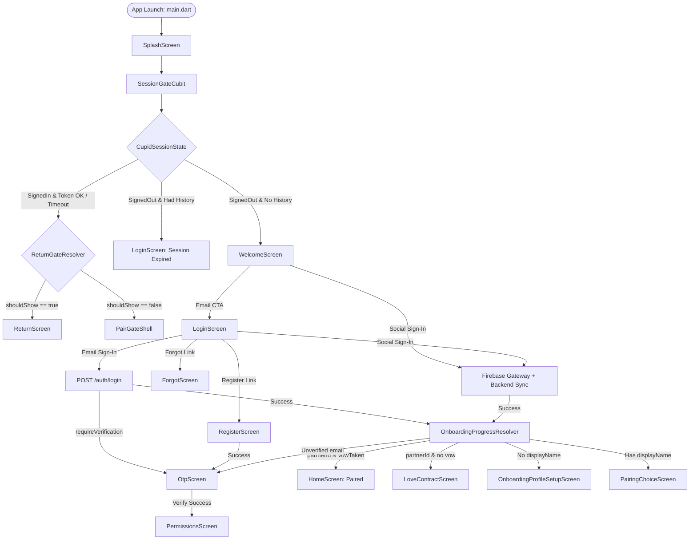

# Báo cáo khảo sát mobile: Chặng 1 — Khởi động và xác thực

- **Tài liệu tham chiếu:** [docs/mobile-ui-to-data-roadmap.md](file:///C:/Users/quang/.gemini/antigravity/worktrees/cupidus/bao_cao_chang_mot/docs/mobile-ui-to-data-roadmap.md)
- **Commit khảo sát:** `76c7e2a6` (*feat: lưu thay đổi hiện tại vào nhánh develop*)
- **Trạng thái working tree:** Sạch (`clean`)
- **Phạm vi khảo sát:** 6 màn hình (`Splash`, `Welcome`, `Login`, `Register`, `OTP`, `Forgot`) và tầng dữ liệu/phiên liên quan (`features/auth/`, `core/auth/`, `core/navigation/`).

---

## 1. Tổng quan kiến trúc xác thực và khởi động

Hệ thống xác thực của Cupidus hoạt động theo mô hình **hybrid**:
1. **Frontend Authentication & Social Gateway:** Sử dụng `FirebaseAuth` (`google_sign_in`, `sign_in_with_apple`, `flutter_facebook_auth`) làm gateway xác thực cho các nhà cung cấp bên thứ ba và quản lý luồng reset mật khẩu.
2. **Backend Authentication & Authorization:** Sử dụng JWT do Cupidus backend API cấp phát (`/auth/login`, `/auth/register`, `/auth/verify-otp`, `/auth/firebase-login`). Token này được gán vào header `Authorization: Bearer <token>` thông qua `CupidAuthInterceptor` cho mọi request nội bộ.
3. **Session & Persistence Management:** `CupidSession` là trung tâm điều phối trạng thái phiên toàn app, kết hợp với `JwtTokenProvider` (lưu JWT) và `AuthHistoryStore` (đánh dấu lịch sử đăng nhập thiết bị).



---

## 2. Bảng chuyển trạng thái phiên (Session State Transitions)

Trạng thái phiên toàn cục được định nghĩa qua `CupidSessionState` và được ánh xạ sang UI state của cổng khởi động `SessionGateState`.

| Trạng thái ban đầu | Kích hoạt / Tác nhân | Điều kiện logic / Nguồn dữ liệu | Trạng thái chuyển đổi (`SessionGateState`) | Đích điều hướng & Hành vi UI | Dẫn chứng Code | Đánh giá |
| :--- | :--- | :--- | :--- | :--- | :--- | :--- |
| Khởi động app (`_currentState = CupidSessionUnknown`) | `CupidSession._init()` chạy tại constructor | Đọc `JwtTokenProvider.readAccessToken()` & `getSavedUserId()` | `CupidSessionSignedIn` (nếu có token & userId) hoặc `CupidSessionSignedOut` | Giữ màn hình Splash ở trạng thái `SessionGateChecking` (animation 3 chấm bobbing, không hiện spinner) | [cupid_session.dart:59-73](file:///C:/Users/quang/.gemini/antigravity/worktrees/cupidus/bao_cao_chang_mot/mobile/lib/core/auth/cupid_session.dart#L59-L73)<br>[session_gate_cubit.dart:71-80](file:///C:/Users/quang/.gemini/antigravity/worktrees/cupidus/bao_cao_chang_mot/mobile/lib/features/auth/presentation/session_gate_cubit.dart#L71-L80) | `[XÁC NHẬN TỪ CODE]` |
| `CupidSessionSignedOut` | `SessionGateCubit._resolveSignedOut()` | `AuthHistoryStore.hasPreviousSession() == false` (hoặc store null) | `SessionGateUnauthenticated` | Sau thời gian dwell tối thiểu 2s, gọi `pushReplacement` chuyển sang `WelcomeScreen` | [session_gate_cubit.dart:87-95](file:///C:/Users/quang/.gemini/antigravity/worktrees/cupidus/bao_cao_chang_mot/mobile/lib/features/auth/presentation/session_gate_cubit.dart#L87-L95)<br>[splash_screen.dart:125-136](file:///C:/Users/quang/.gemini/antigravity/worktrees/cupidus/bao_cao_chang_mot/mobile/lib/features/auth/presentation/screens/splash_screen.dart#L125-L136) | `[XÁC NHẬN TỪ CODE]` |
| `CupidSessionSignedOut` | `SessionGateCubit._resolveSignedOut()` | `AuthHistoryStore.hasPreviousSession() == true` | `SessionGateSessionExpired(prefillEmail)` | Chuyển sang `LoginScreen(sessionExpired: true, prefillEmail: lastEmail)`. Hiển thị snackbar "Phiên đăng nhập đã hết hạn" và tiêu đề "Đăng nhập lại" | [session_gate_cubit.dart:93-95](file:///C:/Users/quang/.gemini/antigravity/worktrees/cupidus/bao_cao_chang_mot/mobile/lib/features/auth/presentation/session_gate_cubit.dart#L93-L95)<br>[login_screen.dart:157-173](file:///C:/Users/quang/.gemini/antigravity/worktrees/cupidus/bao_cao_chang_mot/mobile/lib/features/auth/presentation/screens/login_screen.dart#L157-L173) | `[XÁC NHẬN TỪ CODE]` |
| `CupidSessionSignedIn` | `SessionGateCubit._resolveSignedIn(email)` | `_idToken().timeout(3s)` thành công hoặc timeout (`TimeoutException`) | `SessionGateAuthenticated` | Tự động ghi lại `authHistoryStore.markAuthenticated(email)`. Kiểm tra `ReturnGateResolver`: nếu cần mở lại chapter closure -> `ReturnScreen`, ngược lại -> `PairGateShell` | [session_gate_cubit.dart:97-118](file:///C:/Users/quang/.gemini/antigravity/worktrees/cupidus/bao_cao_chang_mot/mobile/lib/features/auth/presentation/session_gate_cubit.dart#L97-L118)<br>[splash_screen.dart:146-165](file:///C:/Users/quang/.gemini/antigravity/worktrees/cupidus/bao_cao_chang_mot/mobile/lib/features/auth/presentation/screens/splash_screen.dart#L146-L165) | `[XÁC NHẬN TỪ CODE]` |
| `CupidSessionSignedIn` | `SessionGateCubit._resolveSignedIn(email)` | `_idToken()` ném ngoại lệ khác (ví dụ token revoked/disabled) | `SessionGateSessionExpired(prefillEmail: email)` | Chuyển sang `LoginScreen` với biến thể hết hạn phiên | [session_gate_cubit.dart:115-117](file:///C:/Users/quang/.gemini/antigravity/worktrees/cupidus/bao_cao_chang_mot/mobile/lib/features/auth/presentation/session_gate_cubit.dart#L115-L117) | `[XÁC NHẬN TỪ CODE]` |
| Bất kỳ (trong phiên đang chạy) | `CupidAuthInterceptor.onError()` nhận HTTP 401 khi gọi API | Không phải đường dẫn `/auth/`, chưa retry, và `_refreshToken()` trả về `null` | `SessionTerminationReason.refreshFailed` | `CupidSession.signOut()` được gọi -> `SessionTerminationListener` bắt event và gọi `router.resetTo(context, OnboardingNode.login)` | [cupid_auth_interceptor.dart:62-81](file:///C:/Users/quang/.gemini/antigravity/worktrees/cupidus/bao_cao_chang_mot/mobile/lib/core/auth/cupid_auth_interceptor.dart#L62-L81)<br>[session_termination_listener.dart:59-74](file:///C:/Users/quang/.gemini/antigravity/worktrees/cupidus/bao_cao_chang_mot/mobile/lib/core/navigation/session_termination_listener.dart#L59-L74) | `[XÁC NHẬN TỪ CODE]` |
| Đang đăng nhập | Người dùng chọn Đăng xuất (`SignOutAction`) | Xác nhận dialog đăng xuất | `SignOutSuccess` & phát `SessionTerminationReason.userInitiated` | Xóa sạch token, session, Firebase session, và toàn bộ ScopedStores (bao gồm cả lịch sử phiên `AuthHistoryStore`). `SessionTerminationListener` gọi `router.resetTo(context, OnboardingNode.welcome)` | [sign_out_cubit.dart:45-58](file:///C:/Users/quang/.gemini/antigravity/worktrees/cupidus/bao_cao_chang_mot/mobile/lib/features/auth/presentation/sign_out_cubit.dart#L45-L58)<br>[session_termination_listener.dart:67-74](file:///C:/Users/quang/.gemini/antigravity/worktrees/cupidus/bao_cao_chang_mot/mobile/lib/core/navigation/session_termination_listener.dart#L67-L74) | `[XÁC NHẬN TỪ CODE]` |

---

## 3. Bảng API Authentication chi tiết

| Thao tác | HTTP Method & Path | Headers | Payload gửi đi | DTO Phản hồi thành công | Xử lý & Mapping lỗi | Nơi gọi & Dẫn chứng Code |
| :--- | :--- | :--- | :--- | :--- | :--- | :--- |
| **Đăng nhập Email** | `POST /auth/login` | Mặc định (JSON) | `{"email": string, "password": string}` (email được trim & lowercase) | `{ requireVerification?: bool, accessToken?: string, user?: { id: string, email: string, ... } }` | - `requireVerification == true` -> ném `EmailNotVerifiedFailure`<br>- HTTP 401 -> ném `InvalidCredentialFailure`<br>- Khác -> `UnexpectedAuthFailure(message)` | [auth_repository.dart:37-75](file:///C:/Users/quang/.gemini/antigravity/worktrees/cupidus/bao_cao_chang_mot/mobile/lib/features/auth/data/auth_repository.dart#L37-L75) |
| **Đăng ký Email** | `POST /auth/register` | Mặc định (JSON) | `{"email": string, "password": string, displayName?: string}` | `{ message?: string, ... }` | - HTTP 409 -> ném `EmailAlreadyInUseFailure`<br>- Khác -> `UnexpectedAuthFailure(message)` | [auth_repository.dart:77-102](file:///C:/Users/quang/.gemini/antigravity/worktrees/cupidus/bao_cao_chang_mot/mobile/lib/features/auth/data/auth_repository.dart#L77-L102) |
| **Xác thực mã OTP** | `POST /auth/verify-otp` | Mặc định (JSON) | `{"email": string, "code": string}` (code 6 chữ số) | `{ accessToken: string, user: { id: string, email: string, ... } }` | - DioException -> ném `OtpInvalidFailure(message)` (ghép chuỗi message nếu là List) | [auth_repository.dart:104-141](file:///C:/Users/quang/.gemini/antigravity/worktrees/cupidus/bao_cao_chang_mot/mobile/lib/features/auth/data/auth_repository.dart#L104-L141) |
| **Gửi lại mã OTP** | `POST /auth/resend-otp` | Mặc định (JSON) | `{"email": string}` | `{ message?: string }` | - DioException -> ném `OtpInvalidFailure(message)` | [auth_repository.dart:143-165](file:///C:/Users/quang/.gemini/antigravity/worktrees/cupidus/bao_cao_chang_mot/mobile/lib/features/auth/data/auth_repository.dart#L143-L165) |
| **Đồng bộ Social Login** | `POST /auth/firebase-login` | `Authorization: Bearer <Firebase_ID_Token>` | `{"idToken": string}` | `{ accessToken?: string, user?: { id: string, email: string, ... } }` | - DioException -> ném `e.error` hoặc `UnexpectedFailure()` | [auth_repository.dart:228-260](file:///C:/Users/quang/.gemini/antigravity/worktrees/cupidus/bao_cao_chang_mot/mobile/lib/features/auth/data/auth_repository.dart#L228-L260) |
| **Quên mật khẩu (Fallback)** | `POST /auth/forgot-password` | Mặc định (JSON) | `{"email": string}` | `{ message?: string }` | - DioException -> ném `UnexpectedAuthFailure(message)`. Lưu ý: Khi có `_gateway`, hàm sẽ gọi Firebase `sendPasswordResetEmail` thay vì gọi endpoint này! | [auth_repository.dart:202-217](file:///C:/Users/quang/.gemini/antigravity/worktrees/cupidus/bao_cao_chang_mot/mobile/lib/features/auth/data/auth_repository.dart#L202-L217) |

---

## 4. Quản lý lưu trữ Token, User ID, Email và Vòng đời Phiên

Toàn bộ dữ liệu xác thực bền vững được lưu qua `SharedPreferences` trên client:

| Khóa lưu trữ (`Key`) | Kiểu dữ liệu | Lớp sở hữu (`Store`) | Phạm vi (`Scope`) | Thời điểm ghi | Thời điểm xóa / Teardown | Dẫn chứng Code |
| :--- | :--- | :--- | :--- | :--- | :--- | :--- |
| `cupid_jwt_access_token` | `String` | `JwtTokenProvider` | Phiên người dùng hiện tại (kèm in-memory cache `_cachedToken`) | Sau khi `POST /auth/login`, `POST /auth/verify-otp`, hoặc `POST /auth/firebase-login` trả về `accessToken` | `CupidSession.signOut()` -> `JwtTokenProvider.clearSession()` | [jwt_token_provider.dart:7, 20, 28](file:///C:/Users/quang/.gemini/antigravity/worktrees/cupidus/bao_cao_chang_mot/mobile/lib/core/auth/jwt_token_provider.dart#L7-L28) |
| `cupid_user_email` | `String` | `JwtTokenProvider` | Phiên người dùng hiện tại | Cùng lúc với `cupid_jwt_access_token` | `JwtTokenProvider.clearSession()` khi sign out | [jwt_token_provider.dart:8, 21, 29](file:///C:/Users/quang/.gemini/antigravity/worktrees/cupidus/bao_cao_chang_mot/mobile/lib/core/auth/jwt_token_provider.dart#L8-L29) |
| `cupid_user_id` | `String` | `JwtTokenProvider` | Phiên người dùng hiện tại (ID của backend Cupidus) | Cùng lúc với `cupid_jwt_access_token` | `JwtTokenProvider.clearSession()` khi sign out | [jwt_token_provider.dart:9, 22, 30](file:///C:/Users/quang/.gemini/antigravity/worktrees/cupidus/bao_cao_chang_mot/mobile/lib/core/auth/jwt_token_provider.dart#L9-L30) |
| `auth.has_previous_session_v1` | `bool` | `AuthHistoryStore` | Toàn thiết bị (Device-local marker ADR-3) | Bất cứ khi nào xác thực thành công (`_onAuthenticated`) hoặc tự phục hồi phiên tại Splash | Xóa khi người dùng chủ động Đăng xuất (`clearOnSignOut()`). **KHÔNG** xóa khi token hết hạn giữa chừng (để giữ cờ phân biệt giữa user mới và user hết hạn phiên) | [auth_history_store.dart:16, 37, 51](file:///C:/Users/quang/.gemini/antigravity/worktrees/cupidus/bao_cao_chang_mot/mobile/lib/core/auth/auth_history_store.dart#L16-L51) |
| `auth.last_email_v1` | `String` | `AuthHistoryStore` | Toàn thiết bị (dùng điền sẵn trường email khi hết hạn phiên) | Khi đăng nhập email thành công; bị xóa nếu đăng nhập social không cung cấp email | Xóa khi chủ động Đăng xuất (`clearOnSignOut()`) | [auth_history_store.dart:17, 38-42, 52](file:///C:/Users/quang/.gemini/antigravity/worktrees/cupidus/bao_cao_chang_mot/mobile/lib/core/auth/auth_history_store.dart#L17-L52) |
| `_cachedToken` (RAM) | `String?` | `JwtTokenProvider` | In-memory singleton | Đọc lần đầu từ disk hoặc set từ `saveSession` | Đặt về `null` khi `clearSession()` | [jwt_token_provider.dart:11, 18, 26](file:///C:/Users/quang/.gemini/antigravity/worktrees/cupidus/bao_cao_chang_mot/mobile/lib/core/auth/jwt_token_provider.dart#L11-L26) |

> [!IMPORTANT]
> **Đối chiếu thực tế implementation `refreshAccessToken` (`JwtTokenProvider` lines 52–54):**
> ```dart
> @override
> Future<String?> refreshAccessToken() async {
>   return readAccessToken();
> }
> ```
> Code implementation thực tế **không gọi bất kỳ endpoint nào để refresh JWT** và cũng không refresh Firebase token. Nó chỉ đơn giản đọc lại chính token đang lưu trong `SharedPreferences` hoặc `_cachedToken`. Nếu token đó đã hết hạn ở server, `refreshAccessToken()` vẫn trả về chính token hết hạn đó. Khi `CupidAuthInterceptor` retry lại với token này, request tiếp tục nhận lỗi 401 và bị ném ra UI/caller. Đây là một điểm giới hạn kiến trúc quan trọng cần lưu ý (xem mục 6).

---

## 5. Cấu trúc Navigation Stack và Luồng Chuyển Màn

### 5.1. Stack điều hướng sau Login thành công
1. Người dùng nhập thông tin tại `LoginScreen` (hoặc `WelcomeScreen` với Social).
2. Sau khi xác thực API thành công, `_resolveAndRoute` gọi `OnboardingProgressResolver.resolve()`:
   - Gửi request `GET /users/me` (qua `AccountRepository.fetchProfile()`).
   - Kiểm tra trạng thái ghép đôi và tiến trình:
     - Đã ghép đôi & đã vow (`profile.partnerId != null && profile.vowTaken`):
       - Gọi `OnboardingRouter.resetTo(context, OnboardingNode.home)`. Stack bị xóa toàn bộ (`pushAndRemoveUntil`), chỉ còn `PairGateShell` -> `HomeScreen`.
     - Đã ghép đôi & chưa vow (`profile.partnerId != null && !profile.vowTaken`):
       - Gọi `OnboardingRouter.resetTo(context, OnboardingNode.loveContract)`. Stack xóa sạch về `LoveContractScreen`.
     - Chưa xác thực email (`!await _reloadEmailVerified()`):
       - Gọi `OnboardingRouter.resetTo(context, OnboardingNode.otp)`.
     - Chưa có tên hiển thị (`profile.displayName == null`):
       - Gọi `Navigator.pushAndRemoveUntil` mở `OnboardingProfileSetupScreen(profile: profile)`.
     - Mặc định còn lại:
       - Gọi `OnboardingRouter.resetTo(context, OnboardingNode.pairingChoice)`.
3. Toàn bộ các nhánh đều sử dụng phương thức xóa sạch stack cũ (`resetTo` / `pushAndRemoveUntil`), do đó người dùng **không thể bấm Back của Android để quay lại màn hình Login hay Welcome**.

### 5.2. Stack điều hướng sau Logout / Session Termination
1. Người dùng ấn "Đăng xuất" tại menu hoặc cài đặt (`SignOutAction`).
2. Mở dialog xác nhận `showSignOutConfirmDialog(context)`.
3. Sau khi xác nhận, `SignOutCubit.signOut()`:
   - Gọi `AuthRepository.signOut()` -> `CupidSession.signOut()`.
   - `CupidSession.signOut()` xóa storage token, xóa Firebase session, phát `CupidSessionSignedOut`, và kích hoạt `clearOnSignOut()` trên danh sách `_scopedStores` (trong đó có `AuthHistoryStore`).
   - Phát tín hiệu `SessionTerminationNotifier.emit(SessionTerminationReason.userInitiated)`.
4. Widget `SessionTerminationListener` (được gắn tại root của `PairGateShell`) nhận event:
   - Nếu `userInitiated`: Gọi `OnboardingRouter.resetTo(context, OnboardingNode.welcome)`. Toàn bộ app stack bị xóa, người dùng được đưa về `WelcomeScreen`.
   - Nếu `refreshFailed`: Gọi `OnboardingRouter.resetTo(context, OnboardingNode.login)`. Stack bị xóa và người dùng được đưa về `LoginScreen` để đăng nhập lại.

---

## 6. Phiếu khảo sát chi tiết từng màn hình (Survey Sheets)

### Phiếu 1: Màn hình Splash (`SplashScreen`)
```text
Màn / route / commit: SplashScreen / Entry Route ('/') / commit 76c7e2a6
Điểm vào và điều kiện mở: Được mount làm thuộc tính `home:` trong CupidApp (app/cupid_app.dart:97). Là điểm vào đầu tiên khi khởi động ứng dụng.
File UI + dòng: mobile/lib/features/auth/presentation/screens/splash_screen.dart:34-221
Vùng giao diện và thao tác:
  - Hero logo Cupid Logo với hiệu ứng mở cung (arc) và nảy (bounce).
  - Wordmark "Cupid" (Nunito 900 / 58px / -0.03em) với hiệu ứng popIn.
  - Vùng hiệu ứng BreathingGlow (vầng sáng thở) và 3 chấm bobbing (_BobbingDots).
  - Dòng trạng thái (_StatusLine) ở sát mép dưới (safeBottom + 26dp).
  - Không có nút bấm hay thao tác tương tác của người dùng (ADR-6 loại bỏ tap affordance).
Callback → handler:
  - initState: khởi tạo Timer(_minDwell = 2 giây, callback: _tryNavigate).
  - BlocListener<SessionGateCubit, SessionGateState>: lắng nghe state chuyển đổi và kích hoạt _tryNavigate.
State owner / vòng đời / initial state:
  - State owner: SessionGateCubit (presentation/session_gate_cubit.dart:51).
  - Vòng đời: Khởi tạo cùng SplashScreen, bị hủy khi pushReplacement sang màn hình tiếp theo.
  - Initial state: SessionGateChecking.
Loading / success / empty / error / offline:
  - Loading / Checking: Hiển thị 3 chấm bobbing, không dùng spinner rời.
  - Authenticated: _navigateAuthenticated() -> kiểm tra ReturnGateResolver (shouldShow). Nếu true mở ReturnScreen, false mở PairGateShell.
  - Unauthenticated: Chuyển WelcomeScreen.
  - SessionExpired: Chuyển LoginScreen(sessionExpired: true, prefillEmail: prefillEmail).
  - Offline / Timeout: ADR-011h đặt timeout 3 giây cho _idToken(), nếu TimeoutException xảy ra thì coi như thành công lạc quan (SessionGateAuthenticated) để không chặn người dùng khi offline hoặc mạng chậm.
Domain/service (nếu có): ReturnGateResolver (features/chapter_closure/domain/return_gate_resolver.dart).
Repository và đăng ký DI:
  - CupidSession đăng ký lazy singleton tại core/di/service_locator.dart:153.
  - AuthRepository đăng ký lazy singleton tại core/di/service_locator.dart:608.
API: method + path + payload + parse + failure: Không gọi trực tiếp HTTP request (ADR-011h: splash chỉ đọc cache cục bộ và kiểm tra session stream).
Local: table/key/file + owner scope:
  - SharedPreferences keys: cupid_jwt_access_token, cupid_user_id, cupid_user_email, auth.has_previous_session_v1, auth.last_email_v1.
Nguồn dữ liệu gốc / chính sách cache: SharedPreferences + in-memory state của CupidSession & FirebaseAuth.currentUser.
Kết quả → state → UI:
  - SessionGateState -> _SplashViewState._tryNavigate -> Navigator.pushReplacement.
Side effect: navigation / notification / timer / subscription:
  - Timer: _dwellTimer (2 giây).
  - Subscription: StreamSubscription<CupidSessionState> trong SessionGateCubit.
  - Navigation: pushReplacement sang Welcome, Login, ReturnScreen hoặc PairGateShell.
Rời màn / logout / account switch: Rời màn qua pushReplacement, hủy Timer và đóng SessionGateCubit.
Test liên quan và kết quả đã chạy:
  - mobile/test/features/auth/presentation/splash_screen_test.dart (11 test case, PASS 100%).
  - mobile/test/features/auth/presentation/session_gate_cubit_test.dart (PASS 100%).
Xác nhận từ code (file:dòng): splash_screen.dart:87-174, session_gate_cubit.dart:71-118
Quan sát runtime: Flutter test chạy mượt mà, thời gian dwell 2s và logic fallback timeout 3s hoạt động chính xác.
Suy luận: Việc coi TimeoutException là SessionGateAuthenticated giúp app mở offline tức thì vào Home nếu đã có session hợp lệ.
Chưa rõ / bước kiểm chứng tiếp: Cần kiểm chứng trường hợp backend thu hồi token trên server thì sau khi Splash bypass vào Home, request đầu tiên ở Home sẽ bị 401 như thế nào.
```

---

### Phiếu 2: Màn hình Welcome (`WelcomeScreen`)
```text
Màn / route / commit: WelcomeScreen / OnboardingNode.welcome / commit 76c7e2a6
Điểm vào và điều kiện mở:
  - Mở từ SplashScreen khi trạng thái phiên là SessionGateUnauthenticated (lần đầu cài app hoặc sau khi đăng xuất).
  - Mở từ SessionTerminationListener khi nhận event SessionTerminationReason.userInitiated.
File UI + dòng: mobile/lib/features/auth/presentation/screens/welcome_screen.dart:46-424
Vùng giao diện và thao tác:
  - Hero: Tiêu đề wordmark "Cupid", khẩu hiệu "Yêu nghiêm túc. Chia tay đàng hoàng.", phụ đề app cho hai người.
  - Nút CTA "Tiếp tục với Apple" (chỉ hiển thị trên iOS).
  - Nút CTA "Tiếp tục với Google" (Google brand mark).
  - Nút CTA Outlined "Dùng email".
  - Chân trang ghi chú điều khoản dí dỏm.
Callback → handler:
  - "Tiếp tục với Google" -> context.read<SignInCubit>().signInWithGoogle().
  - "Tiếp tục với Apple" -> context.read<SignInCubit>().signInWithApple().
  - "Dùng email" -> _openLogin -> _router.push(context, OnboardingNode.login).
State owner / vòng đời / initial state:
  - State owner: SignInCubit (presentation/sign_in_cubit.dart:31).
  - Initial state: SignInIdle.
Loading / success / empty / error / offline:
  - Loading: SignInInProgress hoặc _resolving -> vô hiệu hóa toàn bộ nút CTA (`isBusy = true`), hiện trạng thái chờ.
  - Success: SignInSuccess -> gọi _resolveAndRoute(context) -> OnboardingProgressResolver.resolve().
  - Error: SignInFailed -> ScaffoldMessenger hiển thị SnackBar thông báo lỗi (authFailureMessage).
Domain/service (nếu có): OnboardingProgressResolver, OnboardingRouter.
Repository và đăng ký DI: AuthRepository (core/di/service_locator.dart:608).
API: method + path + payload + parse + failure:
  - Social: Google/Apple SDK -> FirebaseAuth.signInWithCredential -> POST /auth/firebase-login (payload: { idToken }).
Local: table/key/file + owner scope: SharedPreferences (ghi auth.has_previous_session_v1, cupid_jwt_access_token).
Nguồn dữ liệu gốc / chính sách cache: FirebaseAuth provider credentials + backend JWT.
Kết quả → state → UI: SignInState -> BlocConsumer.listener -> SnackBar hoặc _resolveAndRoute.
Side effect: navigation / notification / timer / subscription:
  - Navigation: push sang Login hoặc resetTo sang các node onboarding/home.
Rời màn / logout / account switch: Màn hình bị gỡ khỏi cây widget khi người dùng chuyển sang Login hoặc đăng nhập thành công.
Test liên quan và kết quả đã chạy:
  - mobile/test/features/auth/presentation/screens/welcome_screen_test.dart.
  - Quan sát: 1 test thất bại do sai lệch nhỏ về alpha của star field layer trên backdrop (Expected within 0.02 of 1.0, Actual 0.741).
Xác nhận từ code (file:dòng): welcome_screen.dart:59-140, 285-339
Quan sát runtime: Luồng push sang Login và các thao tác giao diện phản hồi tốt.
Suy luận: Welcome là trung tâm tiếp nhận người dùng mới và là đích đến của mọi thao tác đăng xuất chủ động.
Chưa rõ / bước kiểm chứng tiếp: Cần cấu hình Firebase mock cho các bài test social sign in độc lập.
```

---

### Phiếu 3: Màn hình Đăng nhập (`LoginScreen`)
```text
Màn / route / commit: LoginScreen / OnboardingNode.login / commit 76c7e2a6
Điểm vào và điều kiện mở:
  - Nhấn "Dùng email" từ WelcomeScreen.
  - Splash phát hiện session hết hạn (SessionGateSessionExpired).
  - SessionTerminationListener nhận tín hiệu refreshFailed khi gọi API bị 401.
File UI + dòng: mobile/lib/features/auth/presentation/screens/login_screen.dart:89-696
Vùng giao diện và thao tác:
  - Header: "Chào mừng trở lại" hoặc "Đăng nhập lại" (nếu sessionExpired).
  - Card nhập Email (có hỗ trợ prefillEmail).
  - Card nhập Password kèm nút ẩn/hiện mật khẩu.
  - Link "Quên mật khẩu?" với vùng chạm mở rộng tapTarget.
  - Nút Primary "Đăng nhập".
  - Hàng nút Social (Google, Facebook, Apple trên iOS).
  - Link chân trang "Chưa có tài khoản? Đăng ký".
Callback → handler:
  - Nút Đăng nhập -> context.read<SignInCubit>().signInWithEmail(email, password).
  - Nút Quên mật khẩu -> _openForgot -> _router.push(context, OnboardingNode.forgotPassword).
  - Nút Đăng ký -> _openRegister -> _router.push(context, OnboardingNode.register).
  - Nút Social -> SignInCubit.signInWithGoogle / Apple / Facebook.
State owner / vòng đời / initial state:
  - State owner: SignInCubit (presentation/sign_in_cubit.dart:31).
  - Form state: _emailController, _passwordController, _passwordObscured cục bộ.
  - Initial state: SignInIdle.
Loading / success / empty / error / offline:
  - Loading: isBusy = true (nút Đăng nhập chuyển spinner inline, khóa thao tác).
  - Success: SignInSuccess -> _resolveAndRoute -> OnboardingProgressResolver.resolve().
  - Error (EmailNotVerifiedFailure): Tự động chuyển tiếp sang OnboardingNode.otp (_router.push).
  - Error khác: Hiển thị errorText màu đỏ bên dưới nút.
  - Session Expired variant: Tự động bật SnackBar một lần: "Phiên đăng nhập đã hết hạn".
Domain/service (nếu có): OnboardingProgressResolver, OnboardingRouter.
Repository và đăng ký DI: AuthRepository (core/di/service_locator.dart:608).
API: method + path + payload + parse + failure:
  - POST /auth/login, payload: {"email": email, "password": password}. Parse response lấy requireVerification hoặc accessToken + user.
  - Thất bại: HTTP 401 (InvalidCredentialFailure), các mã khác (UnexpectedAuthFailure).
Local: table/key/file + owner scope: SharedPreferences ghi JWT và User ID, cập nhật BackendUserIdStore.
Nguồn dữ liệu gốc / chính sách cache: Backend REST API /auth/login.
Kết quả → state → UI: SignInState cập nhật giao diện và điều hướng.
Side effect: navigation / notification / timer / subscription:
  - SnackBar hiển thị qua addPostFrameCallback khi hết hạn phiên.
  - Navigation: push sang Forgot, Register, OTP hoặc resetTo chuỗi onboarding.
Rời màn / logout / account switch: Dispose controller, hủy subscription Cubit khi rời màn hình.
Test liên quan và kết quả đã chạy: mobile/test/features/auth/presentation/screens/login_screen_test.dart (PASS 100%).
Xác nhận từ code (file:dòng): login_screen.dart:107-245, 330-450
Quan sát runtime: Xử lý email không phân biệt hoa thường (.trim().toLowerCase()) và bắt đúng lỗi EmailNotVerifiedFailure để đẩy qua OTP.
Suy luận: Màn hình được thiết kế phục vụ cả 2 ngữ cảnh: đăng nhập lần đầu và đăng nhập phục hồi sau khi phiên hết hạn.
Chưa rõ / bước kiểm chứng tiếp: Kiểm tra trải nghiệm khi server backend bị sập hoàn toàn (kết nối mạng timeout 10s).
```

---

### Phiếu 4: Màn hình Đăng ký (`RegisterScreen`)
```text
Màn / route / commit: RegisterScreen / OnboardingNode.register / commit 76c7e2a6
Điểm vào và điều kiện mở: Nhấn "Đăng ký" từ LoginScreen hoặc chuyển từ OnboardingChain.
File UI + dòng: mobile/lib/features/auth/presentation/screens/register_screen.dart:74-593
Vùng giao diện và thao tác:
  - Header: "Tạo tài khoản", phụ đề "Một người tạo, người kia ghép vào sau bằng mã".
  - Card nhập "Tên gọi" (Display name) viết hoa chữ cái đầu.
  - Card nhập "Email".
  - Card nhập "Mật khẩu" kèm thanh đo độ mạnh mật khẩu (Password Strength Meter 4 phân đoạn).
  - Checkbox chấp thuận điều khoản dịch vụ (_TermsConsentRow).
  - Nút Primary "Đăng ký".
  - Link "Đã có tài khoản? Đăng nhập".
Callback → handler:
  - Nút Đăng ký -> context.read<RegisterCubit>().registerWithEmail(email, password, displayName).
  - Link Đăng nhập -> _openLogin -> _router.replaceWith(context, OnboardingNode.login).
  - Password text change -> _onPasswordChanged -> tính toán lại điểm độ mạnh (_passwordStrength).
State owner / vòng đời / initial state:
  - State owner: RegisterCubit (presentation/register_cubit.dart:31).
  - Initial state: RegisterIdle.
Loading / success / empty / error / offline:
  - Loading: RegisterInProgress -> Nút hiển thị spinner inline, khóa tương tác.
  - Success: RegisterSuccess -> _router.replaceWith(context, OnboardingNode.otp) (AC2: tiến vào màn OTP, không nhảy thẳng vào Home).
  - Error: RegisterFailed -> Hiển thị errorText màu đỏ (ví dụ: EmailAlreadyInUseFailure: "Email này đã được sử dụng").
Domain/service (nếu có): OnboardingRouter.
Repository và đăng ký DI: AuthRepository (core/di/service_locator.dart:608).
API: method + path + payload + parse + failure:
  - POST /auth/register, payload: {"email": email, "password": password, "displayName": displayName}.
  - Thất bại: HTTP 409 (EmailAlreadyInUseFailure), khác (UnexpectedAuthFailure).
Local: table/key/file + owner scope: Ghi pendingEmail vào bộ nhớ AuthRepository và lưu AuthHistoryStore.
Nguồn dữ liệu gốc / chính sách cache: Backend REST API /auth/register.
Kết quả → state → UI: RegisterState điều khiển hiển thị lỗi hoặc kích hoạt replaceWith sang OTP.
Side effect: navigation / notification / timer / subscription:
  - Navigation: replaceWith sang OTP hoặc Login (ngăn chặn stack đăng ký lồng nhau).
Rời màn / logout / account switch: Controllers dispose, hủy listener mật khẩu.
Test liên quan và kết quả đã chạy: mobile/test/features/auth/presentation/screens/register_screen_test.dart (PASS 100%).
Xác nhận từ code (file:dòng): register_screen.dart:97-175, register_cubit.dart:36-52
Quan sát runtime: Thuật toán đo mật khẩu chấm điểm dựa trên độ dài >= 6, >= 10, có số, có ký tự đặc biệt; hiển thị nhãn "Mạnh" khi đạt từ 3 điểm trở lên.
Suy luận: Sử dụng replaceWith sang OTP đảm bảo người dùng không thể Back lại form đăng ký sau khi đã tạo tài khoản thành công.
Chưa rõ / bước kiểm chứng tiếp: Xác thực ký tự đặc biệt trong trường Display Name có bị backend chặn không.
```

---

### Phiếu 5: Màn hình Xác thực OTP (`OtpScreen`)
```text
Màn / route / commit: OtpScreen / OnboardingNode.otp / commit 76c7e2a6
Điểm vào và điều kiện mở:
  - Tự động chuyển sang sau khi Đăng ký thành công (`RegisterScreen`).
  - Chuyển sang từ `LoginScreen` khi tài khoản chưa xác thực (`EmailNotVerifiedFailure`).
  - Chuyển sang từ `OnboardingProgressResolver` nếu `reloadEmailVerified` trả về false.
File UI + dòng: mobile/lib/features/auth/presentation/screens/otp_screen.dart:25-536
Vùng giao diện và thao tác:
  - Badge icon `mark_email_unread`.
  - Tiêu đề "Nhập mã xác thực", hiển thị email đích nhận mã.
  - Ô nhập mã OTP 6 chữ số (_codeLength = 6) với bàn phím số.
  - Nút Primary "Xác thực".
  - Nút "Gửi lại mã" kèm bộ đếm lùi thời gian cooldown 60 giây.
Callback → handler:
  - Nhập đủ 6 số hoặc bấm nút Xác thực -> _otpCubit.verifyCode(code).
  - Nhấn Gửi lại mã -> _otpCubit.resendCode().
State owner / vòng đời / initial state:
  - State owner: OtpCubit (presentation/otp_cubit.dart:45).
  - Vòng đời: Tạo mới khi mount OtpScreen, tự động kích hoạt bộ đếm ngược 60s cooldown; hủy timer khi close.
  - Initial state: OtpInitial(email: email, resendSeconds: 60).
Loading / success / empty / error / offline:
  - Loading: OtpInProgress -> khóa nút, hiển thị trạng thái đang gửi request.
  - Success: OtpSuccess -> hủy timer cooldown -> gọi _router.goNext(context, OnboardingNode.otp) -> chuyển tiếp sang PermissionsScreen.
  - Error: OtpFailed -> Hiển thị thông báo lỗi cụ thể (ví dụ: mã OTP sai hoặc hết hạn).
Domain/service (nếu có): OnboardingRouter, OnboardingChain.
Repository và đăng ký DI: AuthRepository (core/di/service_locator.dart:608).
API: method + path + payload + parse + failure:
  - Verify: POST /auth/verify-otp, payload: {"email": email, "code": code}. Parse accessToken và user object.
  - Resend: POST /auth/resend-otp, payload: {"email": email}.
Local: table/key/file + owner scope:
  - Lưu accessToken, userId, email vào SharedPreferences qua CupidSession.setSession().
  - Cập nhật BackendUserIdStore.
Nguồn dữ liệu gốc / chính sách cache: Backend REST API /auth/verify-otp.
Kết quả → state → UI: OtpState cập nhật số giây cooldown mỗi 1 giây và điều hướng khi thành công.
Side effect: navigation / notification / timer / subscription:
  - Timer: Timer.periodic(Duration(seconds: 1)) quản lý đếm lùi cooldown.
  - Navigation: _router.goNext chuyển sang OnboardingNode.permissions.
Rời màn / logout / account switch: Timer bị hủy qua OtpCubit.close(), text controller và focus node được dispose.
Test liên quan và kết quả đã chạy: mobile/test/features/auth/otp_screen_test.dart (PASS 100%).
Xác nhận từ code (file:dòng): otp_screen.dart:72-115, otp_cubit.dart:57-137
Quan sát runtime: Cooldown 60s đếm chính xác, khi hết 60s nút Gửi lại mã tự động sáng trở lại; nhập đủ 6 ký tự tự động submit.
Suy luận: Việc lưu session ngay tại bước OTP verify thành công giúp người dùng chính thức đăng nhập vào hệ thống trước khi vào chuỗi onboarding.
Chưa rõ / bước kiểm chứng tiếp: Chưa có cơ chế SMS fallback, hiện hoàn toàn dựa vào Email OTP.
```

---

### Phiếu 6: Màn hình Quên Mật Khẩu (`ForgotScreen`)
```text
Màn / route / commit: ForgotScreen / OnboardingNode.forgotPassword / commit 76c7e2a6
Điểm vào và điều kiện mở: Nhấn "Quên mật khẩu?" từ LoginScreen (_openForgot).
File UI + dòng: mobile/lib/features/auth/presentation/screens/forgot_screen.dart:45-285
Vùng giao diện và thao tác:
  - Badge icon khoá xoay (CupidIcons.lockReset).
  - Tiêu đề "Quên mật khẩu là chuyện thường", văn bản an ủi "kỷ niệm vẫn còn nguyên".
  - Card nhập Email.
  - Nút Primary "Gửi link đặt lại".
  - Hộp ghi chú bảo mật (shieldMoon): "Đổi mật khẩu không làm mất ảnh trong Private Gallery — khoá đó nằm trong máy bạn".
  - Nút Back vật lý hoặc cử chỉ vuốt để quay lại màn hình Login.
Callback → handler:
  - Nút "Gửi link đặt lại" -> _submit -> AuthRepository.sendPasswordResetEmail(email).
State owner / vòng đời / initial state:
  - State owner: Quản lý cục bộ qua State<_ForgotScreenState> (không có Cubit riêng theo đặc tả thiết kế).
  - Initial state: _isBusy = false, _sent = false, _failure = null.
Loading / success / empty / error / offline:
  - Loading: _isBusy = true -> vô hiệu hóa nút submit.
  - Success: _sent = true -> Hiển thị thông báo màu xanh bạc hà (colorMint): "Đã gửi email đặt lại mật khẩu.". Không tự động chuyển màn hình.
  - Error: _failure != null -> Hiển thị text lỗi màu đỏ (colorRed).
Domain/service (nếu có): Không có domain riêng.
Repository và đăng ký DI: AuthRepository (core/di/service_locator.dart:608).
API: method + path + payload + parse + failure:
  - Khi có _gateway (production): gọi FirebaseAuth.sendPasswordResetEmail(email: email).
  - Khi không có _gateway (preview/fallback): gọi POST /auth/forgot-password với payload: {"email": email}.
Local: table/key/file + owner scope: Không lưu trữ dữ liệu local.
Nguồn dữ liệu gốc / chính sách cache: Firebase Auth service hoặc REST API backend.
Kết quả → state → UI: setState cập nhật _sent và _isBusy để đổi trạng thái UI.
Side effect: navigation / notification / timer / subscription: Không có timer hoặc auto-navigation; giữ người dùng trên màn hình để họ đọc thông báo rồi tự back.
Rời màn / logout / account switch: Dispose _emailController khi back về LoginScreen.
Test liên quan và kết quả đã chạy: mobile/test/features/auth/presentation/screens/forgot_screen_test.dart (PASS 100%).
Xác nhận từ code (file:dòng): forgot_screen.dart:66-85, 204-222, auth_repository.dart:202-217
Quan sát runtime: Giao diện hiển thị đúng tone ấm áp và ghi chú an tâm về mã hóa ảnh gallery local.
Suy luận: Màn hình này là một terminal node (nút cụt trong OnboardingChain), người dùng chỉ có thể quay lại bằng phím Back.
Chưa rõ / bước kiểm chứng tiếp: Cần kiểm tra template email reset password thực tế được gửi từ Firebase hay backend để đảm bảo đồng nhất nhận diện thương hiệu.
```

---

## 7. Các vấn đề kỹ thuật và Rủi ro phát hiện trong Chặng 1

1. **Khuyết thiếu cơ chế Refresh Token thực thụ ở tầng REST Client (`JwtTokenProvider`):**
   - **Hiện trạng:** `JwtTokenProvider.refreshAccessToken()` chỉ đơn thuần đọc lại `readAccessToken()` từ `SharedPreferences`.
   - **Rủi ro:** Khi access token backend hết hạn (thường sau 15–60 phút), `CupidAuthInterceptor` sẽ lấy lại chính token hết hạn đó để retry, dẫn đến việc retry chắc chắn thất bại 401 lần 2. Sau đó, interceptor sẽ kích hoạt `onSessionExpired` và đẩy người dùng ra màn hình `LoginScreen` với lý do `refreshFailed`. Người dùng sẽ bị văng ra đăng nhập lại rất thường xuyên nếu không có background refresh endpoint thật sự.
2. **Hardcoded `FirebaseAuth.instance` trong `AuthRepository._syncBackendProfile`:**
   - **Hiện trạng:** Dòng 230 của `auth_repository.dart` gọi trực tiếp `FirebaseAuth.instance.currentUser?.getIdToken()` thay vì gọi qua `FirebaseSignInGateway`.
   - **Rủi ro:** Khi chạy unit test mà không khởi tạo Firebase App, mọi bài test liên quan đến social sign in đều bị crash với lỗi `[core/no-app] No Firebase App '[DEFAULT]' has been created`.
3. **Cơ chế Fallback Quên mật khẩu kép:**
   - `AuthRepository.sendPasswordResetEmail` có 2 nhánh: nếu có `_gateway` thì gọi Firebase, ngược lại gọi `POST /auth/forgot-password`. Cần đảm bảo hệ thống production thống nhất dùng một kênh gửi email (Firebase template hoặc backend email service) để tránh phân mảnh dữ liệu người dùng.
