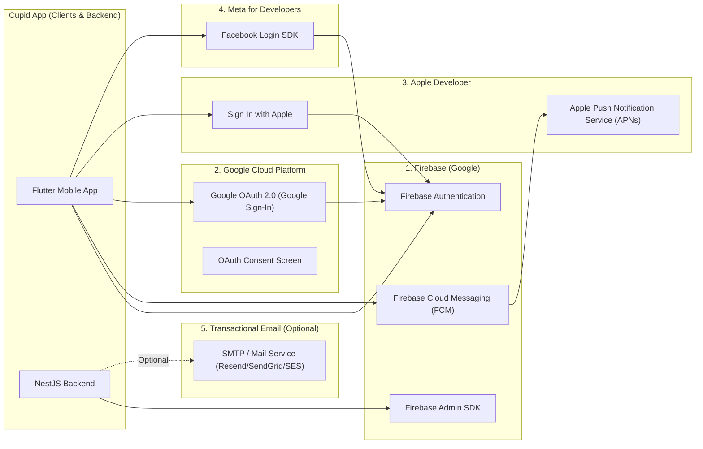

# Danh Sách Cấu Hình Các Dịch Vụ Bên Thứ 3 (3rd-Party Services)

> **Dự án**: Cupid Apps (NestJS Backend + Flutter Mobile + Astro Web)  
> **Ngày cập nhật**: 2026-08-23  
> **Mục đích**: Checklist tổng hợp toàn bộ các tài khoản, dịch vụ đám mây (Cloud/SaaS/PaaS) bên ngoài cần đăng ký, cấu hình và liên kết để ứng dụng hoạt động đầy đủ trên Production.

---

## 🗺️ Tổng Quan Các Dịch Vụ Bên Thứ 3 Cần Tích Hợp



---

## 📋 Checklist Chi Tiết Theo Từng Dịch Vụ

---

### 1. Firebase (Google Firebase Console)
> **Console**: [https://console.firebase.google.com/](https://console.firebase.google.com/)  
> **Project ID hiện tại**: `gen-lang-client-0644970375`

- [ ] **1.1. Firebase Admin SDK (Backend)**:
  - Tải file **`service-account.json`** (*Project Settings -> Service accounts -> Generate new private key*).
  - Cung cấp file này cho Backend để khởi tạo `admin.initializeApp()` và xác thực token người dùng.
- [ ] **1.2. Kích hoạt các phương thức đăng nhập (Sign-in Providers)**:
  - Truy cập *Authentication -> Sign-in method*, bật:
    - **Email/Password**: Bật để người dùng đăng ký/đăng nhập bằng email.
    - **Google**: Bật và liên kết với Google Client ID.
    - **Apple**: Bật và nhập thông tin từ Apple Developer (*Services ID, Team ID, Key ID, Private Key .p8*).
    - **Facebook**: Bật và nhập `App ID`, `App Secret` từ Meta Developers.
- [ ] **1.3. Firebase Cloud Messaging (FCM)**:
  - Kênh thông báo mặc định phía Android: `cupid_realtime_default` (đã khai báo trong `AndroidManifest.xml`).
  - Liên kết **APNs Authentication Key** từ Apple (xem mục 3) vào tab *Project Settings -> Cloud Messaging -> Apple app configuration*.
- [ ] **1.4. Tải file cấu hình Native cho Mobile**:
  - Android: Tải file `google-services.json` đặt vào `mobile/android/app/`.
  - iOS: Tải file `GoogleService-Info.plist` đặt vào `mobile/ios/Runner/`.

---

### 2. Google Cloud Platform (Google OAuth 2.0)
> **Console**: [https://console.cloud.google.com/](https://console.cloud.google.com/)

- [ ] **2.1. Cấu hình OAuth Consent Screen (Màn hình xác thực tài khoản Google)**:
  - Điền **App Name** (`Cupid`), **User support email**, **Developer contact info**.
  - Thêm **Authorized domains**: `cupidus.app`, `api.cupidus.app`, `gen-lang-client-0644970375.firebaseapp.com`.
  - Cung cấp link **Privacy Policy** và **Terms of Service** (`https://cupidus.app/privacy`, `https://cupidus.app/terms`).
  - Xuất bản trạng thái từ *Testing* sang *In Production* (hoặc tiến hành Google App Verification nếu yêu cầu quyền mở rộng).
- [ ] **2.2. Tạo OAuth 2.0 Client IDs**:
  - **Android Client ID**:
    - Package name: `com.snapsofts.cupid`
    - Thêm mã **SHA-1 Fingerprint** của:
      + Keystore phát hành của bạn (`upload-keystore.jks`).
      + **Google Play App Signing key** (lấy từ Google Play Console sau khi upload app).
  - **iOS Client ID**:
    - Bundle ID: `com.snapsofts.cupid`
    - Lấy giá trị `REVERSED_CLIENT_ID` (`com.googleusercontent.apps.591718769021-asok5l4bie49q6bl2e7s4u3700tg8am9`) khai báo vào `CFBundleURLTypes` trong `mobile/ios/Runner/Info.plist`.
  - **Web Client ID**: Dùng để tích hợp với Firebase Auth và Web Client.

---

### 3. Apple Developer Services
> **Portal**: [https://developer.apple.com/account/](https://developer.apple.com/account/)

- [ ] **3.1. Cấu hình App ID**:
  - App ID: `com.snapsofts.cupid`
  - Bật các Capabilities bắt buộc:
    - ✅ **Sign In with Apple**
    - ✅ **Push Notifications**
- [ ] **3.2. Cấu hình Push Notifications (APNs)**:
  - Vào mục *Certificates, Identifiers & Profiles -> Keys -> Tạo Key mới*.
  - Tích chọn **Apple Push Notifications service (APNs)**.
  - Tải file **`AuthKey_XXXXXXXXXX.p8`** (chỉ tải được 1 lần duy nhất), lưu lại **Key ID** và **Team ID**.
  - Upload file `.p8` này lên Firebase Console (*Cloud Messaging*).
- [ ] **3.3. Cấu hình Sign In with Apple cho Firebase**:
  - Tạo **Services ID** (e.g. `com.snapsofts.cupid.signin`).
  - Cấu hình Web Domain (`gen-lang-client-0644970375.firebaseapp.com`) và Return URL (`https://gen-lang-client-0644970375.firebaseapp.com/__/auth/handler`).
  - Tạo **Private Key (.p8)** với quyền *Sign In with Apple*, liên kết với Services ID vừa tạo.
  - Tải file `.p8`, lấy **Key ID**, **Team ID** và cấu hình vào Firebase Auth Provider Apple.
- [ ] **3.4. iOS Native Capability**:
  - Bật *Sign In with Apple* trong Xcode để sinh file `mobile/ios/Runner/Runner.entitlements`.

---

### 4. Meta for Developers (Facebook Login)
> **Portal**: [https://developers.facebook.com/](https://developers.facebook.com/)

- [ ] **4.1. Tạo App & Thiết lập Facebook Login**:
  - Tạo App loại *Consumer / Authentication*.
  - Thêm sản phẩm **Facebook Login for Mobile**.
  - Lấy **App ID** và **Client Token** (*Settings -> Advanced -> Client Token*).
  - Lấy **App Secret** (*Settings -> Basic*).
- [ ] **4.2. Cấu hình Redirect & URLs**:
  - Thêm Valid OAuth Redirect URI: `https://gen-lang-client-0644970375.firebaseapp.com/__/auth/handler`.
  - Cung cấp đường link Privacy Policy URL và User Data Deletion Callback URL.
  - Chuyển chế độ App từ *In Development* sang *Live*.
- [ ] **4.3. Cấu hình Native App**:
  - **Android**:
    - Thêm Key Hashes (SHA-1 chuyển đổi sang base64) của Release Keystore vào mục Android App Settings.
    - Khai báo `facebook_app_id` và `facebook_client_token` vào mã nguồn Android.
  - **iOS**:
    - Khai báo Bundle ID `com.snapsofts.cupid` và cấu hình `CFBundleURLSchemes` (`fb[APP_ID]`) trong `Info.plist`.

---

### 5. Dịch Vụ Gửi Email Giao Dịch / SMTP (Transactional Email) - *Optional*
> *Áp dụng nếu bạn muốn gửi mã OTP 6 số hoặc email thông báo trực tiếp từ Backend thay vì dùng link xác thực của Firebase.*

- [ ] **5.1. Chọn & Đăng ký nhà cung cấp SMTP**:
  - Các nhà cung cấp khuyến nghị: **Resend** ([resend.com](https://resend.com)), **SendGrid**, **Amazon SES**, hoặc **Brevo**.
- [ ] **5.2. Xác thực tên miền gửi thư (Domain Authentication)**:
  - Thêm các bản ghi DNS vào tên miền của bạn:
    - **SPF** (TXT record)
    - **DKIM** (CNAME hoặc TXT records)
    - **DMARC** (TXT record `_dmarc.yourdomain.com`)
  - Đảm bảo điểm danh tiếng tên miền cao để email không vào hòm thư rác (Spam/Junk).
- [ ] **5.3. Thông tin cấu hình Backend**:
  - Lấy API Key / SMTP Credentials điền vào cấu hình backend:
    ```bash
    SMTP_HOST=smtp.resend.com
    SMTP_PORT=587
    SMTP_USER=resend
    SMTP_PASS=re_xxxxxxxxxxxxxx
    SMTP_FROM="Cupid App <noreply@cupidus.app>"
    ```

---

## 📦 Bảng Tổng Hợp Thông Tin & Credentials Cần Chuẩn Bị

| Dịch vụ | Loại thông tin / File cần thu thập | Sử dụng ở đâu |
| :--- | :--- | :--- |
| **Firebase** | File `service-account.json` | Backend (`/usr/src/app/service-account.json`) |
| **Firebase** | File `google-services.json` (đã có SHA-1) | Mobile Android (`mobile/android/app/`) |
| **Firebase** | File `GoogleService-Info.plist` | Mobile iOS (`mobile/ios/Runner/`) |
| **Google Cloud** | Web Client ID & iOS Client ID | Firebase Console + iOS `Info.plist` |
| **Google Cloud** | SHA-1 Keystore phát hành | Google Cloud Console + Firebase |
| **Apple Dev** | APNs Auth Key (`.p8`), Key ID, Team ID | Firebase Console (*Cloud Messaging*) |
| **Apple Dev** | Sign In with Apple Key (`.p8`), Key ID, Services ID | Firebase Console (*Authentication*) |
| **Meta Dev** | Facebook App ID, App Secret, Client Token | Firebase Console + Mobile Native |
| **Email SMTP** | SMTP Host, Port, Username, API Key | Backend `.env` |
